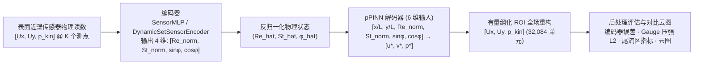

# Fish Surface Sensor Flow (`fish_flow`)

二维静态成鱼绕流表面稀疏传感器状态识别与物理信息神经网络（pPINN）流场重构框架。

---

## 1. 综述

### 1.1 整体模型框架与物理约定

本项目基于 Verma et al. (2020) 二维静态成鱼轮廓（特征体长 $L = 0.200\text{ m}$，来流速度 $U_\infty = 1.0\text{ m/s}$），通过鱼体表面近壁传感器读数重构核心密集区域（ROI：$x/L \in [-0.5, 4.5],\ y/L \in [-0.8, 0.8]$，共 32,084 单元）的瞬时流场，整体框架由**表面传感器编码器**与**参数化物理信息神经网络（pPINN）解码器**两阶段串联构成：



核心物理与科研约束：
- **显式 $St$ 建模**：不使用任何 $Re \mapsto St$ 经验公式；编码器直接预测 4 维 `[Re_norm, St_norm, sinφ, cosφ]`，pPINN 接收 6 维 `[x*, y*, Re_norm, St_norm, sinφ, cosφ]`，PDE 配点在 5 维 `(x*, y*, Re, St, φ)` 独立采样。
- **物理量纲约定**：流场与传感器 3 通道为 `[Ux (m/s), Uy (m/s), p_kin (m^2/s^2)]`（运动压强 $p_{\text{kin}} = p/\rho$），无量纲化采用 `pressure_scale_mode = "uinf2"`（$`u^* = U_x/U_\infty,\ v^* = U_y/U_\infty,\ p^* = p_{\text{kin}}/U_\infty^2$`$）。
- **严格工况防泄漏**：共 16 个雷诺数工况（`13500`–`17500`，无 `17250`），默认划分 `train_re`（12 个）、`val_re`（`14750, 16750`）与锁定 `test_re`（`14250, 16250`），归一化统计量仅在 `train_re` 拟合。

### 1.2 两层解耦架构

- **底层纯参数核心（`src/fish_flow/` 核心子模块）**：数据加载、几何配点、网络架构、物理损失、训练器、推理前向与后处理指标均不读取配置文件，全部通过显式函数/类参数传入。
- **上层单 `config.json` 与 CLI 编排**：通过 `scripts/` 命令行入口结合单份 `config.json`（或命令行参数）驱动数据准备、模型训练、推理与后处理。

### 1.3 文件功能清单

| 目录 / 文件 | 核心功能与职责 |
| :--- | :--- |
| **`configs/`** | |
| `configs/mesh_roi_params.json` | 预处理生成的 ROI 裁剪边界、网格单元索引与候选传感器索引参数 |
| **`runs/example/`** | 受 Git 追踪的配置模板（建议复制到新目录后修改或通过 `--output-dir` 指定输出目录，避免污染示例） |
| `runs/example/{mlp_uniform_24,deepsets,ppinn}/config.json` | 24 点均匀布局 MLP 编码器、DeepSets 动态集合编码器与 pPINN 解码器训练配置示例 |
| `runs/example/infer_{mlp_uniform_24,deepsets_uniform_24,ppinn,mlp_uniform_24_ppinn,deepsets_uniform_24_ppinn}/config.json` | 编码器单独推理（MLP / DeepSets）、解码器单独推理（pPINN）与串联推理（MLP+pPINN / DeepSets+pPINN）配置示例 |
| **`scripts/`** | 命令行统一入口脚本 |
| `scripts/prepare_fish_mesh.py` | 解析 `msh/fish_fluent.msh`，确定 ROI 与候选传感器，输出 `mesh.h5` 与网格对比图 |
| `scripts/preprocess_fish_npz.py` | 循环读取 `data_files/Re*/two_cycles.npz` 与 `cycle_quality.json`，输出 `ReXXX.h5` |
| `scripts/train.py` | 单 `config.json` 训练启动入口，统一调度 MLP / DeepSets / pPINN 训练 |
| `scripts/plot_loss.py` | 读取训练目录或 `history.json`，绘制损失、学习率与验证指标收敛曲线（默认输出 `loss_curve.png`） |
| `scripts/infer.py` | 单 `config.json` 推理启动入口，支持 `encoder` / `decoder` / `cascade` 三种模式 |
| `scripts/postprocess.py` | 推理结果后处理入口，按模式计算物理误差指标并生成对比云图 |
| **`src/fish_flow/`** | 核心 Python 包（需设置 `PYTHONPATH=src`） |
| `src/fish_flow/data/surface_sensors.py` | 提取与读取 504 个壁面近壁单元基础传感器几何与原始物理读数（不含全场） |
| `src/fish_flow/data/encoder_loader.py` | 编码器训练数据加载、仅训练集 `Normalizer` 拟合（MLP 列 Z-score / DeepSets 通道标准化）与随机子集批整理 |
| `src/fish_flow/data/ppinn_loader.py` | pPINN ROI 全场数据加载、`uinf2` 无量纲化、参数归一化器拟合与训练/验证采样 |
| `src/fish_flow/collocation.py` | Verma et al. (2020) 成鱼轮廓固体域判断与 5 维 PDE 配点采样 |
| `src/fish_flow/models.py` | 纯 PyTorch 网络：`SensorMLP`、`DynamicSetSensorEncoder`、`PPINNModel` |
| `src/fish_flow/losses.py` | 编码器 4 维回归损失（`EncoderLoss`）与二维非定常 Navier-Stokes 无量纲 PDE 残差（`PPINNLoss`） |
| `src/fish_flow/training/common.py` | 随机种子、回归/圆周相位指标、`PressureGaugeAccum`、早停、学习率调度与 PDE 权重调度 |
| `src/fish_flow/training/{mlp,deepsets,ppinn}.py` | MLP、DeepSets（含冻结多预算验证面板）与 pPINN 独立训练器及历史记录 |
| `src/fish_flow/config.py` | 单 `config.json` 解析并分发至对应训练器，保存 `best_*.pt` 与 `history.json` |
| `src/fish_flow/plot_loss.py` | 训练历史任务自动识别与 MLP / DeepSets / pPINN 收敛曲线绘制模块 |
| `src/fish_flow/inference/core.py` | ckpt 加载、纯内存物理量纲前向（归一化 → 分块前向 → 反归一化/物理量纲还原）与串联桥接 |
| `src/fish_flow/inference/data.py` | 复用基础数据模块读取未归一化 `.h5` 传感器读数与解码器参数空间/ROI 坐标 |
| `src/fish_flow/inference/runner.py` | 推理配置解析、复制原 `config.json` 至输出目录并导出 `.npz` 结果 |
| `src/fish_flow/postprocess.py` | 推理 `.npz` 与原始 `.h5` 对齐加载、编码器物理误差、全 ROI 与尾流区流场指标及对比云图绘制 |
| **`pyproject.toml` / `environment.yml` / `requirements.txt`** | 项目打包元信息与 Conda / pip 一键环境配置 |
| **`tests/`** | |
| `tests/test_{training,inference,postprocess}_pipeline.py` | 训练、推理与后处理端到端连通性及数学不变性单元测试 |
| `tests/test_plot_loss.py` | 训练损失可视化模块纯参数接口与 CLI 单元测试 |

---

## 2. 整体流程

### 2.0 一键环境配置

在仓库根目录执行以下任一命令即可完成环境创建、依赖安装与 `fish_flow` 可编辑安装（安装后无需手动设置 `PYTHONPATH`）：

**方式一：Conda 一键配置（推荐，含 CUDA 12.4 PyTorch）**

```bash
conda env create -f environment.yml && conda activate fish_flow
```

**方式二：已有 Python（>=3.10）环境 pip 一键配置**

```bash
pip install -r requirements.txt
```

> 若未执行 `-e .` 安装而在已有环境中直接运行，需先设置搜索路径：Windows PowerShell 执行 `$env:PYTHONPATH = "src"`，Linux/macOS 执行 `export PYTHONPATH=src`。

### 2.1 数据预处理（`.msh` + `.npz` → `.h5`）

> 若 `data/processed/` 下已包含预处理好的 `mesh.h5` 与 `Re13500.h5` ~ `Re17500.h5`（且含 `/sensors/wall_*` 数据集），可直接跳过本节进入 `2.2`；从零复现时需自备原始 CFD 工况目录（含 `Re*/two_cycles.npz` 与 `Re*/cycle_quality.json`，该原始数据目录未随仓库分发）。

**第一步：网格解析与核心密集区（ROI）提取**

读取 `msh/fish_fluent.msh`，转换至鱼头原点无量纲坐标系，截取密集区域 `x/L ∈ [-0.5, 4.5], y/L ∈ [-0.8, 0.8]`（32,084 单元）并抽取候选传感器：

```powershell
python scripts/prepare_fish_mesh.py
```

输出：`configs/mesh_roi_params.json`、`data/processed/mesh.h5`、`docs/mesh_roi_overview.png`。

**第二步：工况数据裁剪与 HDF5 打包**

单线程循环读取原始工况目录下的 `Re*/two_cycles.npz` 与 `cycle_quality.json`，提取 ROI 流场、真实 `St` 与弧度相位：

```powershell
python scripts/preprocess_fish_npz.py
# 若原始工况目录不在默认的 data_files/，可通过 --data-dir 指定路径：
python scripts/preprocess_fish_npz.py --data-dir D:\path\to\data_files
```

- 默认参数：`--data-dir data_files`、`--params configs/mesh_roi_params.json`、`--out-dir data/processed`。
- 输出：`data/processed/Re13500.h5` ~ `Re17500.h5`（共 16 个工况，保持原始物理量纲）。

**第三步：构建 504 壁面近壁基础传感器池**

从 `mesh.h5` 与各 `ReXXX.h5` 提取 504 个壁面紧邻流体单元的坐标、逆时针归一化弧长及传感器时序读数：

```powershell
python -m fish_flow.data.surface_sensors
```

要求与说明：
- 该步默认读写 `data/processed/`，会在 `mesh.h5` 写入 `/sensors/wall_xy`、`/sensors/wall_xy_nd`、`/sensors/wall_arc`，并在各 `ReXXX.h5` 写入 `/sensors/wall_uvp`（`[80, 504, 3]`）；所有后续训练与推理均依赖此数据集。

### 2.2 模型训练（`scripts/train.py`）

将示例配置复制到独立实验目录（例如 `runs/my_exp/config.json`）后启动训练，或直接基于 `runs/example/` 下的实际示例目录配合 `--output-dir` 运行以免污染示例目录：

```powershell
python scripts/train.py --config runs/example/mlp_uniform_24 --output-dir runs/my_mlp_uniform_24
python scripts/train.py --config runs/example/deepsets --output-dir runs/my_deepsets
python scripts/train.py --config runs/example/ppinn --output-dir runs/my_ppinn
```

支持通过命令行临时覆盖配置项：

```powershell
python scripts/train.py --config runs/my_mlp_uniform_24 --output-dir runs/my_mlp_v2 --epochs 100 --seed 42 --device cuda
```

具体要求与约定：
- `--config` 可传 `runs/<exp>` 目录或 `runs/<exp>/config.json` 文件。
- 必须确保 `train_re`、`val_re` 与锁定测试集 `test_re`（`14250, 16250`）严格互斥；训练过程绝不读取 `test_re`。
- 默认将最优权重（`best_mlp.pt` / `best_deepsets.pt` / `best_ppinn.pt`，内含模型权重与归一化器统计量）及 `history.json` 保存在 `--output-dir`（默认与 `config.json` 同目录），且**不覆写原 `config.json`**。

### 2.3 训练损失可视化（`scripts/plot_loss.py`）

训练完成后，读取训练输出目录或 `history.json` 绘制损失、学习率与验证指标收敛曲线（默认输出为同目录下的 `loss_curve.png`）：

```powershell
python scripts/plot_loss.py --history runs/example/mlp_uniform_24
python scripts/plot_loss.py --history runs/example/deepsets
python scripts/plot_loss.py --history runs/example/ppinn
```

可选参数与说明：
- `--output`：自定义输出图像路径或目录；`--task`：指定任务类型（默认 `auto` 自动识别）；`--linear`：纵轴改用线性坐标（默认对数坐标）；`--dpi`：图像分辨率（默认 `180`）。
- 对于启用了渐增 `pde_weight_schedule` 预热的 `pPINN` 训练，建议结合 `loss_curve.png` 与 `history.json` 检查 `best_ppinn.pt` 是否落在纯数据预热期，按需在推理阶段与 `last_ppinn.pt` 进行对比。

### 2.4 模型推理（`scripts/infer.py`）

根据配置中的 `mode` 执行三种推理路径，可直接运行 `runs/example/` 下已有的推理配置示例，或自定义推理 `config.json`：

```powershell
# 1. 编码器单独推理（MLP 或 DeepSets）
python scripts/infer.py --config runs/example/infer_mlp_uniform_24
python scripts/infer.py --config runs/example/infer_deepsets_uniform_24

# 2. 解码器单独推理（pPINN）
python scripts/infer.py --config runs/example/infer_ppinn

# 3. 串联推理（编码器 + pPINN，同时输出两者结果）
python scripts/infer.py --config runs/example/infer_mlp_uniform_24_ppinn
python scripts/infer.py --config runs/example/infer_deepsets_uniform_24_ppinn
```

如需临时替换权重、切换输出路径或在最终评测时指定测试工况 `re_list`：

```powershell
python scripts/infer.py --config runs/example/infer_deepsets_uniform_24_ppinn `
  --encoder-ckpt runs/my_deepsets/best_deepsets.pt `
  --ppinn-ckpt runs/my_ppinn/best_ppinn.pt `
  --re-list 14250 16250 `
  --output-dir runs/test_infer_cascade
```

具体要求与约定：
- **权重前置依赖（尤其串联模式）**：
  - `encoder` 模式需要指定 `encoder_ckpt`（`best_mlp.pt` 或 `best_deepsets.pt`）；
  - `decoder` 模式需要指定 `ppinn_ckpt`（`best_ppinn.pt` 或 `last_ppinn.pt`）；
  - `cascade` 串联模式必须同时指定**已训练的编码器权重（`--encoder-ckpt` / 配置项 `encoder_ckpt`）**与**已训练的 pPINN 解码器权重（`--ppinn-ckpt` / 配置项 `ppinn_ckpt`）**，例如串联各自训练产物 `runs/my_deepsets/best_deepsets.pt` 与 `runs/my_ppinn/best_ppinn.pt`。
- **物理量纲输入输出**：所有推理模式的输入（传感器物理读数或物理参数空间）与输出（`Re_hat, St_hat, phase_hat` 与重构流场 `[Ux, Uy, p_kin]`）均为**未无量纲化、未归一化的原始物理量纲**；归一化、串联双归一化器物理桥接与分块前向均在内部完成。
- **输出内容**：推理结束后将原 `config.json` 原样复制至输出目录，并生成对应 `.npz` 文件：
  - `encoder` → `encoder_pred.npz`（`re_pred`, `st_pred`, `phase_pred`, `phase_sin_pred`, `phase_cos_pred`, `re_id`, `sensor_indices`）
  - `decoder` → `decoder_pred.npz`（`uvp_pred`, `xy`, `re_input`, `st_input`, `phase_input`, `re_id`）
  - `cascade` → `cascade_pred.npz`（同时包含上述编码器预测与解码器流场输出）

### 2.5 后处理与评估（`scripts/postprocess.py`）

指定推理模式、模型推理输出路径与原始 `.h5` 数据路径，按需计算编码器/流场物理指标并绘制对比云图（以下路径对应 `runs/example/` 中已有的推理示例）：

```powershell
# 编码器后处理
python scripts/postprocess.py --mode encoder --pred runs/example/infer_mlp_uniform_24 --raw data/processed

# 解码器后处理（指定绘图帧下标）
python scripts/postprocess.py --mode decoder --pred runs/example/infer_ppinn --raw data/processed --frame-idx 0

# 串联后处理（同时评估编码器与流场，并指定输出目录）
python scripts/postprocess.py --mode cascade --pred runs/example/infer_deepsets_uniform_24_ppinn --raw data/processed --output-dir runs/post_cascade
```

具体要求与约定：
- `--pred` 可传推理 `.npz` 文件路径或包含默认 `*_pred.npz` 的输出目录；程序会自动读取同目录 `config.json` 的 `periodic_only` 设置并按 `re_id` 与原始 `ReXXX.h5` 逐帧对齐。
- 按推理模式自动分流：
  - `encoder`：输出 `metrics.json`（含 `Re / St` 回归误差与相位圆周误差）及 `encoder_comparison.png`；
  - `decoder`：输出 `metrics.json`（含全 ROI 速度相对 $L_2$、Gauge 零点对齐压强相对 $L_2$ 与尾流区指标）及各工况 `field_comparison_Re*_f*.png`（`Ux`、`Uy`、Gauge 对齐 `p_kin` 真值/预测/绝对误差 3×3 对比云图）；
  - `cascade`：同时产出上述两套指标与对比图。
- 如仅需数值指标无需出图，可追加 `--no-plot`；如需仅评估部分工况，可追加 `--re-list <Re...>`。

### 2.6 单元测试验证

验证训练、损失可视化、推理与后处理端到端链路是否正常（全部使用临时目录，不在工作区残留输出）：

```powershell
pytest -v tests/test_training_pipeline.py tests/test_plot_loss.py tests/test_inference_pipeline.py tests/test_postprocess_pipeline.py
```

---

## 3. 后续实验规划

围绕表面传感器编码器（`MLP` / `DeepSets`）、物理信息解码器（`pPINN`）以及线性降阶基线（`SurfacePOD`），后续消融与对比实验均遵循 **“单变量控制 + 原始精度与串联精度双指标评估（`encoder` / `decoder` + `cascade`）”** 原则，并在最终对比中使用锁定测试工况 `test_re = [14250, 16250]`。

> **POD 基线统一口径**：`SurfacePOD` 基底与线性映射仅在 `train_re` 上拟合（严禁使用 `val_re` / `test_re`），与各实验同传感器布局/同噪声输入下进行流场重构精度（全 ROI 与尾流区相对 $L_2$、Gauge 压强误差）横向对比。

### 3.1 实验一：不同激活函数对 DeepSets 与 MLP 性能的影响

- **研究目的**：对比不同非线性激活函数对编码器状态识别精度（`Re / St / Phase`）以及串联流场重构精度的影响，并以 `SurfacePOD` 作为无非线性编码的线性流场重构参考线。
- **实验设计**：
  - **自变量**：`model.activation`（当前已支持 `relu`、`tanh`、`gelu`、`identity`，可按需扩展 `silu` 等）。
  - **控制变量**：固定传感器配置、训练轮数、学习率与随机种子，并固定同一份最优 `pPINN` 权重用于串联推理。
  - **评估路径**：`encoder` 单独推理（原始回归与圆周相位误差）+ `cascade` 串联推理（全 ROI 与尾流区流场误差），并与同测点 `SurfacePOD` 重构精度对比。

### 3.2 实验二：不同传感器数量对 DeepSets、MLP 与 POD 基线性能的影响（固定 60 点候选池内均匀取点）

- **研究目的**：验证稀疏测点预算变化下，固定布局 `MLP`、动态集合 `DeepSets` 与线性 `SurfacePOD` 的重构精度退化规律。
- **实验设计**：
  - **候选总池**：统一限定在 `mesh.h5` 预置的 60 个等弧长候选点（`cand60`）内部，按弧长均匀抽取不同传感器数量 $K$（例如 $`K \in \{6, 12, 18, 24, 36, 48, 60\}`$）。
  - **模型对比方式**：
    - `MLP`：针对每个 $K$ 分别训练与推理对应输入维度 `3*K` 的固定网络；
    - `DeepSets`：在 `sensor_pool = "cand60"` 上进行多预算随机子集训练（仅训练一次），推理时依次在 60 点内均匀取 $K$ 点测试动态泛化能力；
    - `SurfacePOD`：在完全相同的 $K$ 个传感器读数上拟合线性观测-模态映射，作为全量级对比基线。
  - **评估路径**：`encoder` 原始精度 + `cascade` 串联精度 + `SurfacePOD` 流场重构精度。
  - **代码衔接备注**：当前 `uniform_arc` 是在 504 全壁面点上等距抽取；正式开展本实验前，需在选位逻辑中支持“仅在 `cand60` 子池内按弧长均匀抽点”（或由脚本生成对应的 `sensor_indices`），并补齐 `SurfacePOD` 模块。

### 3.3 实验三：不同 PDE 权重对 pPINN 原始误差及串联推理精度的影响

- **研究目的**：探究物理控制方程残差约束强度对纯解码重构精度以及上游编码器误差传播敏感度的影响，并以 `SurfacePOD` 与纯数据驱动基线（`lambda_phys = 0.0`）作参照。
- **实验设计**：
  - **自变量**：`training.lambda_phys`（如 `0.0`、`0.01`、`0.1`、`1.0`、`5.0` 等）及可选 `pde_weight_schedule`（`constant / linear / cosine` 等）。
  - **控制变量**：固定 `pPINN` 网络结构与 5D 配点设置，并固定同一组最优编码器权重（`MLP` / `DeepSets`）作为串联上游。
  - **评估路径**：`decoder` 单独推理（真实参数输入下的 `pPINN` 原始流场误差）+ `cascade` 串联推理（编码器预测状态驱动下的端到端流场误差），并与 `SurfacePOD` 基线对比。

### 3.4 实验四：不同高斯噪声强度对 DeepSets、MLP 与 POD 基线性能的影响

- **研究目的**：评估传感器物理读数受到测量噪声污染时，`MLP`、`DeepSets` 串联重构与 `SurfacePOD` 线性重构的鲁棒性。
- **实验设计**：
  - **自变量**：推理期注入传感器物理读数 `[Ux, Uy, p_kin]` 的高斯噪声相对强度 $\eta$（例如 $`\eta \in \{0\%, 1\%, 3\%, 5\%, 10\%\}`$，以训练集各通道标准差 $`\sigma_{\text{train}, c}`$ 为基准：$`\tilde{x}_c = x_c + \mathcal{N}(0, (\eta \cdot \sigma_{\text{train}, c})^2)`$）。
  - **对比维度**：在同噪声输入下横向对比 `MLP`、`DeepSets`（含无噪训练与开启 `sensor_noise_rel_std` 增强训练两版）以及 `SurfacePOD`。
  - **评估路径**：`encoder` 原始精度 + `cascade` 串联精度 + `SurfacePOD` 含噪重构精度（固定多组测试噪声种子求均值与标准差）。
  - **代码衔接备注**：当前仅 `DeepSets` 训练期支持 `sensor_noise_rel_std`；正式开展本实验前，需在推理模块补充统一的推理期高斯噪声注入参数（按训练集统计量标定噪声尺度）。

### 3.5 实验五：基于 DeepSets 可变输入特性的贪心算法最佳传感器布局探索（可选进阶）

- **研究目的**：利用 `DeepSets` 对任意传感器数量与排列的置换不变推理能力，无需为每组候选布局重新训练网络，直接通过贪心搜索发掘鱼体表面最具信息量的关键传感器分布（若暂不开展贪心搜索，可优先完成简化的 **实验十二**）。
- **实验设计**：
  - **搜索策略**：基于在候选池（`cand60` 或 504 壁面点）上训练好的单一 `DeepSets` 模型，在验证集 `val_re` 上执行序列贪心选位（前向逐步添加 $0 \to K$ 或后向逐步剪枝 $N_{\text{cand}} \to K$），以验证集状态预测误差（或经 `pPINN` 串联后的流场重构误差）为选位目标函数，严格避免接触锁定测试集 `test_re`。
  - **对照验证**：在相同预算 $K$ 下，将搜索得到的 `DeepSets-Greedy` 布局与弧长均匀布局（`uniform`）、水动力关键区先验布局（`physics_layout`）对比，并把该最优布局迁移给固定布局 `MLP` 与 `SurfacePOD` 进行重训与测试集（`14250 / 16250`）评估，验证“关键测点物理规律可迁移性”及在鱼体头部/肩部/尾柄的测点聚集特征。

### 3.6 实验六：pPINN 不同 PDE 配点重采样策略及物理一致性验证

- **研究目的**：对比不同 PDE 配点刷新频率对 5 维 `(x*, y*, Re, St, φ)` 空间物理残差覆盖度、训练耗时与流场重构精度的影响，并通过独立的物理一致性指标验证模型是否真正满足控制方程而非仅过拟合固定配点。
- **实验设计**：
  - **自变量**：`training.resample_collocation_mode`，对比三种策略：
    - `fixed`：训练全程使用同一批固定配点（验证固定点集是否导致“局部过拟合配点、未采样区残差偏高”）；
    - `epoch`：每个 epoch 重新采样一次配点（当前默认，兼顾空间覆盖与采样开销）；
    - `batch`：每个梯度更新 step / batch 重新采样一次配点（在当前 `PPINNTrainer` 中每步对应一个监督 `batch`，即每 step / batch 均刷新配点）。
  - **控制变量**：固定 `n_collocation`、`collocation_method`（如 `latin_hypercube`）、`collocation_re_st_mode`、`pde_weight_schedule`、网络结构与随机种子。
  - **评估路径（数据精度 + 物理一致性双验证）**：
    - **流场重构精度**：`decoder` 单独推理 + `cascade` 串联推理（全 ROI 与尾流区速度/Gauge 压强相对 $L_2$）；
    - **物理一致性验证**：在未参与训练的测试工况 `test_re = [14250, 16250]` 全 ROI 网格及独立加密 5D 测试配点集上，调用自动微分物理残差接口计算 X 动量残差 $r_u$、Y 动量残差 $r_v$ 与连续性散度残差 $r_c = \nabla \cdot \mathbf{u}^*$ 的均方根（RMS）及空间分布图，同时记录各策略单轮训练耗时（`wall_time_seconds`）以衡量精度-算力权衡。
  - **代码衔接备注**：训练期配点重采样（`fixed` / `epoch` / `batch`）与 `losses.compute_pde_residuals` 已原生支持；正式开展物理一致性验证前，需在 `postprocess.py`（或独立评估脚本）补充基于已保存 `best_ppinn.pt` / `last_ppinn.pt` 对测试集计算独立 PDE 残差 $(r_u, r_v, r_c)$ 的评估流程。

### 3.7 实验七：不同学习率调度策略对 MLP、DeepSets 与 pPINN 的影响

- **研究目的**：评估不同学习率衰减机制对三类模型收敛速度、验证集震荡幅度、最优轮次（`best_epoch`）以及最终泛化精度的影响，验证当前默认 `cosine` 余弦退火相比固定学习率或其他衰减策略的收益。
- **实验设计**：
  - **自变量**：`training.lr_scheduler.strategy`，统一对比：
    - `constant`（全程恒定学习率）；
    - `cosine`（当前示例默认余弦退火）；
    - `step` / `multistep`（阶梯衰减）；
    - `plateau`（基于验证指标停滞自适应降学习率，仅依赖可观测验证指标）。
  - **控制变量**：固定初始 `learning_rate`、`num_epochs`、早停设置（建议关闭 `early_stopping.enabled` 以观察完整退火周期，或保持一致的早停配置）、传感器布局及随机种子。
  - **评估路径**：结合 `scripts/plot_loss.py` 对比训练/验证收敛曲线，并在锁定测试集 `test_re` 上评估 `encoder`、`decoder` 与 `cascade` 指标。

### 3.8 实验八：pPINN 不同 PDE 权重调度训练策略对比

- **研究目的**：对比“纯数据预热后分段递增物理权重”与“全程恒定物理权重”等不同训练课程（curriculum）策略对 pPINN 数据拟合与物理约束平衡的影响，定位两阶段优化中 `best_ppinn.pt` 与 `last_ppinn.pt` 的精度差异来源。
- **实验设计**：
  - **自变量**：`training.pde_weight_schedule.strategy` 及对应阶段参数：
    - `constant`：全程保持恒定 `lambda_phys`（无预热，从第 1 轮起直接联合优化数据与 PDE 残差）；
    - `cosine`：当前默认分段策略（前 15% 轮次 `start_weight = 0.0` 纯数据预热，中期余弦爬坡至 `1.0`，后期满权重联合收敛）；
    - `linear` / `step`：线性爬坡或阶梯增权策略作为对照；
    - 可选对照 `lambda_phys = 0.0`（纯数据驱动基线）。
  - **控制变量**：固定最终目标 `lambda_phys`、配点模式（`epoch`）、网络结构与余弦学习率调度，并固定同一上游编码器权重用于串联对比。
  - **评估路径**：同时评测每组实验保存的 **`best_ppinn.pt` 与 `last_ppinn.pt`**（避免预热期末尾因尚未施加满权重物理约束而出现虚低数据误差导致选优偏差），对比 `decoder` 精度、`cascade` 精度及独立测试集 PDE 物理残差。

### 3.9 实验九：DeepSets 训练期动态子集池尺度策略对泛化性的影响

- **研究目的**：探究 DeepSets 在每个 batch 随机采样传感器子集时，训练期子集预算池 `training_sensor_counts` 的范围大小（以及候选总池尺度）对模型在**已见预算、内插未见预算与外推极端稀疏/稠密预算**下泛化能力的规律。
- **实验设计**：
  - **自变量一（训练预算池尺度 `data.training_sensor_counts`）**：在固定候选池 `cand60` 下，对比不同跨度的训练预算组合（每个 batch 从池中循环随机抽取一个大小 $K$）：
    - 单预算 / 固定规模组：如 `training_sensor_counts = [24]`（或 `random_subset = false` 全池 60 点训练）；
    - 窄区间局部池：如 `[12, 24, 36]`；
    - 当前基准池：`[6, 12, 24, 36, 48]`；
    - 宽区间跨尺度池：如 `[3, 6, 12, 18, 24, 36, 48, 60]`。
  - **自变量二（可选扩展）**：对比不同候选总池 `data.sensor_pool`（`cand60` 60 点 vs `all` 504 全壁面点）以及是否叠加 `data.token_dropout_prob` 对跨尺度泛化的影响。
  - **评估路径**：在 `test_re = [14250, 16250]` 上覆盖**内插未见预算**（如 $K \in \{9, 15, 30, 42\}$）、**外推预算**（如极稀疏 $K=4$ 与满池 $K=60$）以及跨多种随机布局和等弧长布局，评估 `encoder` 精度与 `cascade` 流场重构精度。

### 3.10 实验十：DeepSets 集合聚合方式与计数特征消融

- **研究目的**：揭示不同置换不变聚合算子与显式传感器数量特征对 `DeepSets` 跨预算泛化性能的影响机理，验证当前 `mean+max` 拼接归一化计数特征的设计优势。
- **实验设计**：
  - **自变量一（集合池化方式 `model.pool`）**：对比 `mean+max`（当前默认）、`mean`、`max`、`sum` 四种置换不变聚合算子（其中 `sum` 对集合规模 $K$ 敏感，而 `mean` / `max` 具有尺度不变性）。
  - **自变量二（计数特征开关 `model.use_count_feature`）**：对比开启（拼接归一化有效传感器数量 `cnt / candidate_count`）与关闭（仅保留聚合嵌入）的影响。
  - **控制变量**：固定候选池 `cand60`、训练子集池 `training_sensor_counts`、隐藏层宽度（`phi_hidden` / `rho_hidden`）、激活函数、学习率调度与随机种子，并固定同一份最优 `pPINN` 权重用于串联推理。
  - **评估路径**：在 `test_re = [14250, 16250]` 上分预算（如 $K \in \{6, 12, 24, 36, 48, 60\}$）统计 `encoder` 误差与 `cascade` 流场重构误差，比较跨尺度稳定性。

### 3.11 实验十一：表面传感器物理通道消融（仅压强 vs 仅速度 vs 全通道）

- **研究目的**：针对水下仿生传感器的工程部署约束（如人工侧线通常仅易采集表面压力，而难以同步测得近壁二维速度），评估单类物理量传感信息是否足以支撑全局状态识别（`Re / St / Phase`）与高精度尾流场重构。
- **实验设计**：
  - **自变量**：传感器输入物理通道组合，对比三组配置：
    - 仅运动压强通道 `[p_kin]`（1 通道）；
    - 仅近壁速度通道 `[Ux, Uy]`（2 通道）；
    - 完整物理读数 `[Ux, Uy, p_kin]`（当前默认 3 通道）。
  - **对比模型**：在相同测点布局（如 `cand60` 内 24 点均匀布局及不同预算 $K$）下横向对比 `MLP`、`DeepSets` 与同通道输入的 `SurfacePOD` 基线。
  - **评估路径**：`encoder` 原始精度（重点观察 `Re` 与相位对压强梯度/速度切变的敏感性差异）+ `cascade` 串联流场重构精度 + `SurfacePOD` 同通道重构对比。
  - **代码衔接备注**：当前训练与推理数据接口默认按全 3 通道 `[Ux, Uy, p_kin]` 构建输入（`DeepSets` `in_dim = 5`，`MLP` `input_dim = 3*K`）；正式开展本实验前，需在 `encoder_loader.py`、`inference/data.py` 与 `config.py` 中补充 `sensor_channels`（如 `["p_kin"]` / `["Ux", "Uy"]` / `["Ux", "Uy", "p_kin"]`）配置解析与动态输入维度适配，并在 `SurfacePOD` 基线中保持同通道输入口径。

### 3.12 实验十二：不同传感器空间布局策略对比（简化版布局消融）

- **研究目的**：作为实验五的轻量化替代/前置对照，无需执行昂贵的贪心搜索，直接对比预设几何布局下表面测点空间分布规律对状态识别与流场重构的影响，验证鱼体不同部位（前缘滞止区、肩部压力梯度区、尾柄涡脱落区）的物理信息贡献差异。
- **实验设计**：
  - **自变量**：在固定传感器预算 $K$（如 $K = 24$，候选范围 `cand60` 或 504 壁面点）下，对比以下典型空间布局策略：
    - **均匀布局（`uniform`）**：沿鱼体闭合轮廓逆时针弧长等距布点；
    - **随机布局（`random`）**：使用多组固定随机种子随机抽取 $K$ 个测点（统计均值与方差）；
    - **头多尾少布局（`head_dense`）**：在鱼体头部与肩部（如 $x/L \in [0, 0.4]$）加密布点、后半段稀疏；
    - **头少尾多布局（`tail_dense`）**：在后半身与尾柄区（如 $x/L \in [0.5, 1.0]$）加密布点、头部稀疏；
    - **单侧/局部缺失布局（可选）**：如仅上表面布点或屏蔽特定区段，检验对称性与局部观测依赖。
  - **模型对比方式**：
    - `MLP` 与 `SurfacePOD`：针对每种固定布局分别训练/拟合与测试；
    - `DeepSets`：直接复用多预算训练好的单一模型，在同一组 `sensor_indices` 上零重训推理对比。
  - **评估路径**：`encoder` 原始精度 + `cascade` 串联流场重构精度 + `SurfacePOD` 同布局重构精度。
  - **代码衔接备注**：训练与推理的 `config.json` 已原生支持显式传入 `sensor_indices`；开展本实验仅需按 `wall_xy_nd` 或 `wall_arc` 预先生成各类布局的下标列表即可，无需修改核心训练与推理代码。
