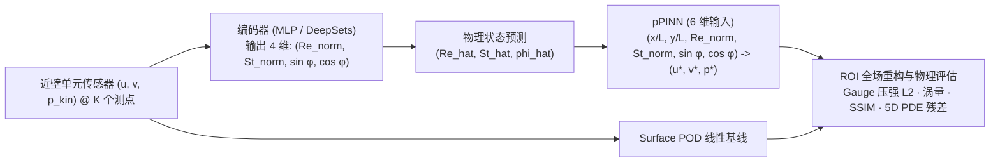

# Fish Surface Sensor Flow (`fish_flow`) 迁移与精简重构设计文档

**日期**: 2026-11-26  
**状态**: 终稿（待分步实施）  
**参考基线**: `_ref/`（`cylinder_flow`，保持只读不修改）  
**目标工作区**: `e:\code\Fish_surface_sensor_flow`

---

## 1. 背景与迁移目标

本项目将原二维圆柱绕流表面稀疏传感器流场重构框架（[_ref/src/cylinder_flow/](file:///e:/code/Fish_surface_sensor_flow/_ref/src/cylinder_flow)）迁移并精简重构为**二维静态成鱼外形绕流**框架（`fish_flow`）。核心变更包括：

1. **几何形状替换**：由圆形圆柱（$D = 0.01\text{ m}$）替换为 Verma et al. (2020) 静态斑马鱼成鱼轮廓（[adult_fish_shape.txt](file:///e:/code/Fish_surface_sensor_flow/msh/adult_fish_shape.txt)，特征体长 $L = 0.200\text{ m}$）。
2. **显式 $St$ 建模（去经验公式）**：
   - 编码器输出由 3 维扩展为 **4 维** `[Re_norm, St_norm, sin φ, cos φ]`；
   - `PPINNModel` 输入由 5 维扩展为 **6 维** `[x/L, y/L, Re_norm, St_norm, sin φ, cos φ]`；
   - PDE 配点由 4 维 `[0, 1)^4` 扩展为 **5 维** `[0, 1)^5` 独立采样 `(x, y, Re, St, φ)`；
   - 彻底移除原圆柱经验公式 `compute_st_from_re`（$f = a + b \cdot Re$）及任何 $Re \mapsto St$ 隐式映射。
3. **新雷诺数工况与数据格式**：接入 [data_files/](file:///e:/code/Fish_surface_sensor_flow/data_files) 下 16 个新雷诺数（`13500`–`17500`）的 `two_cycles.npz` 与 `cycle_quality.json`。
4. **去“屎山”精简重构**：剔除历史遗留兼容层（`Legacy*Package`、Schema v1/v2 分支、8 变体 `ablations.py` 冗余代码、过度嵌套的协议锁模板以及 1.2 万行冗余 parity/smoke 测试），保留清晰轻量的核心管线与严格科研防泄漏守卫。

### 非目标与科研红线
- **不兼容旧圆柱权重**：不加载 `_ref/examples/` 下的旧模型或示例数据。
- **不修改 `_ref/`**：新代码全部位于根目录 `src/fish_flow/`、`configs/`、`scripts/`、`tests/`、`docs/`。
- **严格工况隔离**：`train_re`、`val_re`、`test_re` 严格互斥；归一化器、POD 基底、噪声尺度、SSIM 尺度仅在训练集（或 `train_val_only`）拟合；访问测试集需显式 `--allow-test`。

---

## 2. 新数据与网格实测契约

通过对 [msh/鱼形计算网格说明.md](file:///e:/code/Fish_surface_sensor_flow/msh/鱼形计算网格说明.md)、[data_files/Re13500/cycle_quality.json](file:///e:/code/Fish_surface_sensor_flow/data_files/Re13500/cycle_quality.json) 与 [data_files/Re13500/two_cycles.npz](file:///e:/code/Fish_surface_sensor_flow/data_files/Re13500/two_cycles.npz) 的抽样核查，确立如下输入契约：

- **16 个工况**：`13500, 13750, 14000, 14250, 14500, 14750, 15000, 15250, 15500, 15750, 16000, 16250, 16500, 16750, 17000, 17500`（无 `17250`）。
- **尺度与坐标**：$L = 0.2\text{ m}$，$U_\infty = 1.0\text{ m/s}$；鱼头位于 $(0, 0)$，尾尖位于 $(L, 0)$，最大半厚 $0.04L$。`cell_xy_L` 形状 `(60048, 2)` 覆盖 $x/L \in [-4.5, 25.5],\ y/L \in [-3, 3]$。
- **流场与压强量纲（关键修正）**：
  - `fields` 形状 `(2, 40, 60048, 3)`，通道为 `["Ux_m_s", "Uy_m_s", "kinematic_p_m2_s2"]`。
  - 第 3 通道为**运动压强 $p_{\text{kin}} = p/\rho$**（已验证 `wall_Cp == 2 * fields[:, :, wall_owner, 2]`），因此无量纲化固定使用 **`pressure_scale_mode = "uinf2"`**（即 $p^* = p_{\text{kin}} / U_\infty^2$，不再乘 $\rho = 1000$）。
- **近壁传感器观测（沿用近壁单元质心 3 通道方案）**：
  - `wall_owner` 形状 `(504,)` 为 504 个紧邻壁面的唯一流体单元（前 252 上表面、后 252 下表面，从头到尾有序排列）。
  - 传感器读数取 `fields[:, :, wall_owner, :]`（3 通道 `[Ux, Uy, p_kin]`），传感器坐标取 `cell_xy_L[wall_owner]`（物理坐标 $L \cdot \text{cell\_xy\_L}[\text{wall\_owner}]$）。
- **周期相位与 $St$ 真值**：
  - 每个 `two_cycles.npz` 包含 2 个完整周期 $\times$ 40 相位（共 80 帧），`phase` $\in [0, 0.975]$。预处理转换为 $\phi = 2\pi \cdot \text{phase} \in [0, 2\pi)$，`periodic_mask = ones(80)`。
  - $St$ 真值按无量纲周期计算：$St = 1 / \overline{T^*}$，其中 $\overline{T^*} = \operatorname{mean}(\texttt{periods\_star})$。16 个工况实测 $St \in [2.4680, 2.6463]$（随 $Re$ 单调上升，训练集线性度 $R^2 = 0.9926$）。

---

## 3. 核心架构与工程决策

### 3.1 核心 ROI 裁剪与候选传感器池
- **核心 ROI（基于单元尺度分布）**：
  - 对 `cell_vertices_xy_L` 的面积统计显示，高分辨率网格集中在鱼体周边及近中尾流。在框 **`x/L ∈ [-0.5, 4.5], y/L ∈ [-0.8, 0.8]`** 内共 **$N_{\text{roi}} = 32{,}084$** 个单元（尺度中位数 $\Delta x_{\text{med}} = 0.0090 L$，95 分位 $0.0351 L$，最大 $0.0666 L$），完整覆盖鱼体、$0.5L$ 上游来流、剪切层及 `cycle_quality.json` 的标准尾迹参考区（$1 \le x/L \le 4.5, |y/L| \le 0.4$）。
  - 预处理脚本 `scripts/preprocess_fish_npz.py` 默认以此框裁剪 ROI，并支持通过 `--roi-bounds` 调整。
- **候选传感器池（`N_cand` 全程参数化）**：
  - 代码中**全面取消 `CANDIDATE_COUNT = 60` 硬编码**，全部从 `mesh.ncand` 动态读取。
  - 预处理支持 `--n-candidates`（默认按鱼体闭合周长归一化弧长 $\tau \in [0, 1)$ **等弧长抽样 `60` 个候选点**，与预算 `(6, 12, 24, 48)` 及 `WP-B` 留出预算 `(10, 18, 36)` 无缝配合，同时可随时传 `--n-candidates 120` 或 `504` 生成高密度候选池）。

### 3.2 雷诺数工况划分（`configs/folds.json`）

| 折名 (`fold`) | `train_re` | `val_re` | `test_re` (锁定) |
| :--- | :--- | :--- | :--- |
| `default` | `13500, 13750, 14000, 14500, 15000, 15250, 15500, 15750, 16000, 16500, 17000, 17500` (12) | `14750, 16750` | `14250, 16250` |
| `loo_14750` | 上述 train ∪ `{16750}` (13) | `14750` | `14250, 16250` |
| `loo_16750` | 上述 train ∪ `{14750}` (13) | `16750` | `14250, 16250` |

取消硬编码 `LOCKED_TEST_RE = {250, 650}`，统一由 `ReSplit` 与 `configs/folds.json` 动态确定锁定测试工况。

### 3.3 鱼体几何与选位基线（`fish_flow.geometry` & `layouts/`）
1. **解析轮廓 (`geometry/fish_profile.py`)**：
   - 实现 Verma et al. (2020) 附录 A 的分段半宽函数 $h(s)$（$s = x/L \in [0, 1]$）及向量化 `points_inside_fish(x, y, L)`，用于：
     - `physics/collocation.py` 拒绝采样剔除鱼体内部配点；
     - `evaluation/spatial.py` 计算流体域掩码 `fluid_domain_mask` 与鱼体尾流掩码 `wake_mask`（$1 \le x/L \le 4.5,\ |y/L| \le 0.4$）。
2. **传感器几何参数化 (`geometry/sensors.py`)**：
   - 取消 `sensor_theta` 与单位圆校验 `||pos||_2 == 1`。
   - `MeshData` 存储 `sensor_xy_nd` `(Ncand, 2)`（无量纲坐标 $(x/L, y/L)$）与 `sensor_arc` `(Ncand,)`（逆时针闭合轮廓归一化弧长 $\tau \in [0, 1)$）。
   - DeepSets token 位置特征采用 `position_encoding="xy_nd"`（直接输入 `[x/L, y/L]`，并允许可配置的坐标缩放）。
3. **布局基线 (`layouts/basic.py`)**：
   - `uniform_layout`：沿闭合轮廓归一化弧长 $\tau \in [0, 1)$ 均匀选点（替代原 `linspace(0, 2π)`）。
   - `physics_layout`（工程默认锚点策略）：沿鱼体上下对称轴向位置 $s = x/L$ 按水动力关键区优先选取——优先覆盖**头尖驻点 ($s=0$)、头部最大厚度肩区 ($s/L \in [0.04, 0.15]$) 与尾柄/尾尖涡脱落区 ($s/L \in [0.90, 1.0]$)**，再按镜像对补充躯干中段。

### 3.4 4D 编码器 + 6D pPINN + 5D PDE 配点



- **编码器（`SensorMLP`、`DynamicSetSensorEncoder`）**：
  - `out_dim = 4`：`[Re_norm, St_norm, sin(phi), cos(phi)]`。
  - 新增 `st_normalizer`（仅训练集拟合，随模型检查点持久化）。
  - 训练损失：`loss = loss_re + lambda_st * loss_st + lambda_phase * loss_phase`。
  - `EncoderPrediction` 与回归评估新增 `st`、`st_mae`、`st_rmse`。
- **pPINN（`PPINNModel`）与 5D 配点**：
  - `PPINNModel.forward(x, y, re_val, st_val, phi)` 内部映射为 `[x/L, y/L, Re_norm, St_norm, sin φ, cos φ] -> [u*, v*, p*]`，缓冲包含 `L`、`re_mean/scale`、`st_mean/scale`。
  - `compute_pde_residuals(model, x, y, re_val, st_val, phi, L=None)` 通过链式法则按 $L$ 缩放空间导数，非定常项直接使用传入 `st_val`：$2\pi \cdot St \cdot \partial u^*/\partial \phi$。
  - `sample_collocation_points` 在 **5 维空间 `[0, 1)^5`** 独立采样 `(x, y, Re, St, phi)`（支持 `uniform_random` / `latin_hypercube` / `sobol`）：
    - `continuous_random`（默认）：`Re ∈ [Re_min, Re_max]` 与 `St ∈ [St_min, St_max]` 独立均匀采样（5D 超立方体，不依赖任何经验公式）；
    - `discrete_train_re_random`：从训练集工况中采样真实配对 `(Re_i, St_i)`。
- **选位评分扩展（`layouts/baselines.py` & `layouts/scoring.py`）**：
  - 工程默认决策：`linreg_greedy` 与 pPINN 敏感度二次型同步扩展为 **4 维输出状态** `[Re_norm, St_norm, sin φ, cos φ]`（计算含 $\partial/\partial St$ 的 Jacobian 敏感度矩阵），确保 `St` 预测误差直接纳入布局评估。

### 3.5 去“屎山”精简清单

1. **移除历史兼容层**：删除 `LegacyPPINNPackage`、`LegacyMLPPackage`、`Schema v1 vs v2` 双版本分支、Windows `PosixPath` 旧补丁与 `_ref/examples/`。
2. **移除冗余模型变体**：砍掉 `models/ablations.py`（原 1,264 行含 8 个论文消融变体），集中维护干净的 **`SensorMLP`、`DynamicSetSensorEncoder`、`PPINNModel`、`SurfacePOD`** 四大核心模型。
3. **精简工作流与配置**：保留 **WP-A（选位对比）、WP-B（动态 DeepSets vs 固定 MLP）、WP-C（噪声与缺失鲁棒性）、WP-D（全场重构与空间/物理指标）** 四套精简工作流主干，剥离冗长的冗余 JSON 分析锁套娃校验与超长模板，保持轻量清晰的 CLI 与 `run_meta.json` 溯源。
4. **大幅瘦身测试套件**：不迁移 `_ref/tests/` 的 42 个文件（约 12,000 行 parity/smoke 测试），重建为 **5 个精炼测试文件**，专注核心数学不变性与防泄漏契约：
   - `tests/test_geometry_preprocessing.py`：鱼体轮廓、固体剔除、弧长编码与 `npz -> h5` 预处理校验；
   - `tests/test_data_splits.py`：工况互斥校验、锁定测试集门禁、仅训练集归一化；
   - `tests/test_models_physics.py`：4D 编码器、6D pPINN、5D 配点指纹、解析解 PDE 残差；
   - `tests/test_layouts_metrics.py`：弧长/先验/贪心选位、Welford/Chan Gauge 压强 $L_2$、kNN 涡量与 SSIM；
   - `tests/test_workflows_smoke.py`：最小合成数据下训练 + 闭环推理 + 评估端到端连通性。

---

## 4. 最终项目目录结构

```text
Fish_surface_sensor_flow/
├── _ref/                           # 【只读参考】原圆柱代码
├── data_files/                     # 【原始输入】16 个 ReXXX/two_cycles.npz + cycle_quality.json
├── msh/                            # 【原始网格】adult_fish_shape.txt, fish_fluent.msh, 说明文档
├── pyproject.toml                  # 包名 fish-flow，入口 fish-flow / python -m fish_flow
├── environment.yml / requirements.txt
├── README.md / AGENTS.md
├── configs/
│   ├── paths.example.json
│   ├── folds.json                  # default / loo_14750 / loo_16750
│   ├── geometry_fish.json          # L=0.2, ROI=[-0.5,4.5,-0.8,0.8], wake=[1.0,4.5,-0.4,0.4]
│   └── experiments/wp_{a,b,c,d}/   # 精简后的工作包配置模板
├── scripts/
│   ├── preprocess_fish_npz.py      # npz + cycle_quality -> processed/mesh.h5 + ReXXX.h5
│   └── windows/run_wp_{a,b,c,d}.ps1
├── src/fish_flow/
│   ├── __init__.py / __main__.py / cli.py / config.py
│   ├── geometry/
│   │   ├── __init__.py
│   │   ├── fish_profile.py         # Verma (2020) h(s), points_inside_fish
│   │   └── sensors.py              # 近壁传感器排序、弧长参数化、xy_nd 位置编码与指纹
│   ├── data/                       # types.py, h5.py, preprocessing.py, splits.py, normalization.py, sampling.py
│   ├── physics/                    # scaling.py, collocation.py, residuals.py
│   ├── models/                     # activations.py, mlp.py, deepsets.py, ppinn.py, pod.py
│   ├── training/                   # encoder.py, dynamic_validation.py, ppinn.py, pod.py
│   ├── inference/                  # encoder.py, reconstruction.py
│   ├── layouts/                    # basic.py, baselines.py, greedy.py, scoring.py
│   ├── evaluation/                 # cycles.py, field.py, regression.py, spatial.py, robustness.py, runner.py
│   ├── artifacts/                  # checkpoints.py, results.py, tracking.py
│   ├── analysis/                   # aggregate.py, statistics.py, plotting.py
│   └── workflows/                  # wp_a.py, wp_b.py, wp_c.py, wp_d.py
├── docs/
│   ├── superpowers/specs/2026-11-26-fish-flow-migration-design.md  # 本设计文档
│   ├── architecture.md
│   ├── data_format.md
│   └── metrics.md
└── tests/
    ├── conftest.py
    ├── test_geometry_preprocessing.py
    ├── test_data_splits.py
    ├── test_models_physics.py
    ├── test_layouts_metrics.py
    └── test_workflows_smoke.py
```

---

## 5. 分步迁移计划（待您下达指令后按阶段推进）

1. **Stage 1（脚手架 + 几何 + 数据预处理）**：搭建 `pyproject.toml`、`configs/`、`fish_flow.config`、`geometry/`、`data/` 与 `scripts/preprocess_fish_npz.py`，实测生成 `mesh.h5` 与 16 个 `ReXXX.h5` 并跑通 `test_geometry_preprocessing.py` 与 `test_data_splits.py`。
2. **Stage 2（物理层 + 四大核心模型）**：迁移 `physics/`（`uinf2` 压强缩放、5D 配点、6D pPINN 残差）与 `models/`（4D `SensorMLP` / `DynamicSetSensorEncoder`、6D `PPINNModel`、`SurfacePOD`）并跑通 `test_models_physics.py`。
3. **Stage 3（训练 + 推理 + 选位）**：迁移 `training/`、`inference/`、`layouts/`，对齐 `st_normalizer`、4 维敏感度评分与闭环传递。
4. **Stage 4（评测 + 工件 + 分析 + 精简工作流 + 收尾）**：迁移 `evaluation/`、`artifacts/`、`analysis/`、`workflows/` 与 `cli.py`，完成全部 5 个测试文件与文档对齐。
